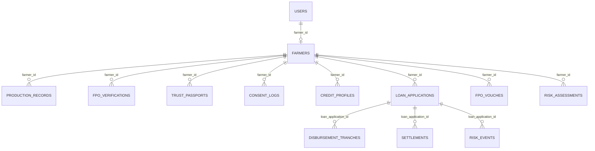

# Kisan Setu — Farmer Trust Passport Platform

[]()
[]()
[]()
[]()
[]()
[]()
[-blue.svg)]()

> **Kisan Setu** (*Bridge for Farmers*) is an agricultural FinTech platform that transforms verified farm records and community trust into an **explainable, portable Agricultural Economic Identity** — the **Farmer Trust Passport**. It eliminates agricultural credit information asymmetry for smallholders, enables Farmer Producer Organizations (FPOs) to earn non-extractive facilitation revenue, and provides rural banks with pre-underwritten, consent-gated, Priority Sector Lending (PSL) origination queues.

---

## Table of Contents

1. [Executive Summary & Problem Statement](#1-executive-summary--problem-statement)
2. [Key Innovations & Differentiators](#2-key-innovations--differentiators)
3. [Revenue Architecture & RBI DLG Mathematical Invariants](#3-revenue-architecture--rbi-dlg-mathematical-invariants)
4. [User Personas & End-to-End Workflows](#4-user-personas--end-to-end-workflows)
5. [Credit Engine & Explainable Risk Engine Math](#5-credit-engine--explainable-risk-engine-math)
6. [System Architecture & Repository Structure](#6-system-architecture--repository-structure)
7. [Comprehensive REST API Reference](#7-comprehensive-rest-api-reference)
8. [Database Schema & Entity Models](#8-database-schema--entity-models)
9. [Edge Cases & System Safeguards](#9-edge-cases--system-safeguards)
10. [Quick Start & Turnkey Demo Setup](#10-quick-start--turnkey-demo-setup)
11. [Automated Testing & Verification](#11-automated-testing--verification)

---

## 1. Executive Summary & Problem Statement

### The Problem
- **Credit Information Asymmetry**: India has over 146 million agricultural households, of which 86% are smallholder and marginal farmers (< 2 hectares). Over $200B in annual formal agricultural credit demand remains unmet because traditional credit bureaus (CIBIL, Experian) lack verified crop, yield, and agronomic data.
- **Opaque Black-Box Scoring**: Commercial lenders frequently rely on proprietary, unexplainable scoring models that fail to capture seasonal crop cycles, regional MSP support, or local community standing.
- **Extractive Intermediary Fees**: Unregulated digital lending apps often charge smallholders extortionate upfront "processing fees", "origination haircuts", and hidden penalties, pushing vulnerable households into debt traps.
- **High Lender Underwriting Costs & NPAs**: Rural banks face high origination and physical verification costs, contributing to over $15B in agricultural Non-Performing Assets (NPAs).

### The Solution: Kisan Setu
Kisan Setu introduces a **non-balance-sheet Lending Service Provider (LSP)** architecture that connects:
1. **The Smallholder Farmer**: Retains 100% data sovereignty via granular, consent-gated, attribute-masked sharing and pays **₹0 in platform or origination fees**.
2. **The Partner FPO**: Conducts ground-level agronomic verification, stakes social reputation through member vouching, and earns **non-extractive facilitation fees from the output value chain** (mandi settlement).
3. **The Rural Bank / Lender**: Obtains turnkey, pre-assessed credit profiles categorized for **RBI Priority Sector Lending (PSL)** with automated milestone-based vendor disbursements.

---

## 2. Key Innovations & Differentiators

| Traditional Agricultural Lending | Kisan Setu Platform |
| :--- | :--- |
| **Black-box credit scoring** with no explanation | **Deterministic, fully explainable formula engine** (Acreage × Yield × Price × Haircut) |
| **Opaque data harvesting** without borrower control | **Farmer-controlled consent gateway** with attribute masking and instant revocation |
| **Extractive borrower fees** (2%–5% loan deductions) | **Strict RBI DLG compliance**: ₹0 borrower charges; platform revenue from B2B bank fees & value chain |
| **Lump-sum cash disbursement** prone to diversion | **Milestone-based tranche engine** paying input vendors directly |
| **Unprotected climate risk** leading to defaults | **Climate shock triggers (drought/pest)** pausing EMI (moratorium) and freezing tranches |
| **Manual PSL compliance reporting** | **Automated PSL categorization** and turnkey RBI-compliant CSV reporting |

---

## 3. Revenue Architecture & RBI DLG Mathematical Invariants

Kisan Setu operates under a strictly **non-extractive, non-balance-sheet revenue model** aligned with the Reserve Bank of India’s **Digital Lending Guidelines (DLG)**.

```
       BANK (Lender)               ESCROW / PLATFORM             FARMER / VALUE CHAIN
             │                             │                               │
  [1] Loan Approved                        │                               │
             ├────── Principal (L) ───────>│                               │
             │                             ├──── Tranche 1 (Inputs) ──────>│ Input Vendor
             │                             ├──── Tranche 2 (Ops) ─────────>│ Ops Vendor
             │                             ├──── Tranche 3 (Harvest) ─────>│ Farmer Account
             │                             │                               │
             │                             │<─── Mandi Produce Sale (V) ───┤ Mandi Buyer
             │                             │                               │
             │                             ├──── 2.0% Facilitation Fee ───>│ FPO Wallet
             │                             ├──── 0.15% Settlement Fee ────>│ Platform Revenue
  [2] EMI Paid                             ├──── Contracted EMI ──────────>│ Bank
             │<───────── EMI ──────────────┤                               │
             │                             └──── Residual Proceeds ───────>│ Farmer Bank Account
```

### Mathematical Proof of Zero Borrower Fees

Let:
- $L$ = Loan principal
- $r_b$ = Contracted annual interest rate
- $n$ = Loan tenure in months
- $M(L, r_b, n)$ = Standard contract monthly annuity (EMI)
- $k \in [1.5\%, 2.0\%]$ = B2B origination fee (billed directly to the bank)
- $F_f$ = Vector of farmer-facing fees

#### Invariant 1: No Borrower Fee Invariant
For every loan and underwrite evaluation, the sum of borrower-facing fees must be identically zero:
$$\sum F_f = 0$$
*Enforced in code:* Verified in `backend/app/services/underwrite_service.py` and asserted in `backend/tests/test_rbi_dlg_invariants.py`.

#### Invariant 2: Effective APR Independence
The borrower's effective APR equals the contract rate with zero fee inflation:
$$\frac{d(\text{EffectiveAPR}_{\text{farmer}})}{dk} = 0 \implies \text{EffectiveAPR}_{\text{farmer}} = r_b$$
$$\text{Total Farmer Outflow} = \sum_{i=1}^n M(L, r_b, n) = L + \text{Interest}(L, r_b, n)$$

#### Invariant 3: Disbursement Integrity
Net principal received equals gross sanctioned principal without platform haircuts:
$$\text{NetDisbursed} = L$$

#### Invariant 4: Settlement Transparency
For a mandi sale of gross value $V$, with FPO facilitation rate $c = 2\%$ and platform settlement rate $s = 0.15\%$:
$$\text{FPO Fee} = V \times c \quad (\text{Value Chain})$$
$$\text{Platform Fee} = V \times s \quad (\text{Value Chain})$$
$$\text{Residual to Farmer} = V \times (1 - c - s) - \text{EMI}$$
All fee deductions appear explicitly on the Mandi Escrow Settlement Receipt. Zero platform fees are ever debited against borrower installments.

---

## 4. User Personas & End-to-End Workflows

### A. Smallholder Farmer
1. **Onboarding**: Registers with a 10-digit mobile number, entering village, acreage, primary crop, and crop season.
2. **Passport Generation**: Triggers deterministic credit calculation yielding component scores and credit tier.
3. **Interactive Simulator**: Experiments with acreage and crop sliders to see real-time recalculation of the Safe Credit Limit.
4. **Consent Gateway**: Reviews bank access requests. Chooses which attributes to share (e.g., landholding, passport) and which to mask (e.g., `mobile` rendered as `xxxxxx3210`). Can instantly revoke consent at any time.
5. **Loan Application**: Submits loan requests aligned with productive purposes (e.g., input finance).
6. **Harvest Repayment Tracker**: Views automatic mandi sale settlements, itemized deductions, and moratorium indicators during climate distress.

### B. Farmer Producer Organization (FPO)
1. **Attestation Portal**: Reviews member onboarding claims, inspects landholding and crop details, and toggles the `member_integrity_flag`.
2. **Social Vouching Engine**: Issues capped, stake-weighted peer vouches (`first_loss` guarantee). Built-in fraud controls reject self-vouching (422) and detect circular reciprocal vouching schemes (409).
3. **Facilitation Fee Wallet**: Automatically accrues 2.0% facilitation fees from mandi value-chain settlements. Wallet balance is transparent and never debited from borrower installments.

### C. Rural Bank / Lending Institution
1. **Pre-Assessed Origination Pipeline**: Accesses `/api/v1/bank/pipeline` or `/api/v1/lender/pipeline` with PSL filters (`Agri <= 2L`, `Small & Marginal Farmer`).
2. **Consent-Gated Masked View**: Accesses farmer profiles only when active consent exists. Revoked consents immediately return `403 Forbidden`.
3. **Underwriting & Milestone Tranche Engine**: Approves loans with structured disbursement tranches:
   - **T1 (40%)**: Seeds & fertilizer input vendors (triggered by planting verification).
   - **T2 (50%)**: Staged operations milestone (triggered by crop progress).
   - **T3 (10%)**: Post-harvest residual (credited directly to farmer account).
4. **PSL Compliance Exporter**: Generates turnkey, timestamped CSV exports formatted for RBI Priority Sector Lending submissions.

---

## 5. Credit Engine & Explainable Risk Engine Math

### 5.1 Safe Credit Limit Formula
Pure-Python, deterministic calculation with zero black-box parameters:

$$\text{Safe Credit Limit} = \text{Acreage} \times \text{Yield}_{\text{per\_acre}} \times \text{Benchmark Price} \times (1 - \text{Risk Haircut})$$

- **Yield & Benchmark Prices**: Sourced from AGMARKNET wholesale modal prices and CACP MSP 2026-27 benchmarks (`app/core/market.py`):
  - Paddy: 18.0 q/acre @ ₹3,700/q (MSP: ₹2,441/q)
  - Wheat: 15.0 q/acre @ ₹2,600/q (MSP: ₹2,585/q)
  - Cotton: 4.5 q/acre @ ₹8,650/q (MSP: ₹8,267/q)
  - Sugarcane: 140.0 q/acre @ ₹350/q (MSP: ₹355/q)
  - Maize: 20.0 q/acre @ ₹2,300/q (MSP: ₹2,410/q)
  - Soybean: 8.5 q/acre @ ₹5,740/q (MSP: ₹5,708/q)
- **Risk Haircut**:
  - **15%**: FPO verified with `member_integrity_flag = True`
  - **20%**: FPO verified without integrity flag / Unverified baseline
  - **35%**: FPO verification rejected

### 5.2 Six Component Scores (0–100)
1. **Identity Score**: Profile completeness (name, mobile, village, district, state) + profile photo + FPO membership.
2. **Landholding Score**: Scaled based on cultivable acreage up to full score threshold (5.0 acres).
3. **Production Score**: Known crop catalog validation and expected gross harvest income bands.
4. **Verification Score**: FPO attestation status (verified with integrity = 100, standard verified = 70, pending = 50, rejected = 10).
5. **Repayment Coverage Score**: Net expected agricultural income divided by proposed repayment demand.
6. **Stability Score**: Farmer tenure and historical platform continuity.

### 5.3 Five-Factor Agricultural Risk Engine
A transparent scorecard weighting agricultural credit risk factors:

| Factor | Weight | Evaluation Criteria |
| :--- | :---: | :--- |
| **Production Stability** | 30% | Coefficient of Variation (CV) across verified multi-year historical harvest yields |
| **Market Price Volatility** | 25% | Crop mandi price swings vs. government Minimum Support Price (MSP) floor |
| **Crop Condition & Insurance** | 20% | Weather distress observations and active PMFBY crop insurance risk transfer (+5% uplift) |
| **Community Trust** | 15% | FPO attestation, member integrity flag, and active first-loss peer vouches (-6% risk discount) |
| **Debt Repayment Capacity** | 10% | Existing debt burden relative to net agricultural income |

### 5.4 Repayment Capacity & TDSR Credit Range
Inverts net crop income annuity into defensible Total Debt Service Ratio (TDSR) bounds:
$$\text{Net Income} = \text{Gross Income} \times (1 - \text{Production Cost Ratio (40\%)})$$
$$\text{Monthly Servicing Low} = \frac{\text{Net Income}}{6} \times \text{TDSR}_{\text{LOW}} (40\%) - \text{Existing Demand}$$
$$\text{Monthly Servicing High} = \frac{\text{Net Income}}{6} \times \text{TDSR}_{\text{HIGH}} (55\%) - \text{Existing Demand}$$
Principal capacity is derived by inverting the standard monthly annuity formula over the specified tenure and interest rate.

### 5.5 Purpose Steering Taxonomy
Steers capital towards income-generating agricultural activities:
- `input_finance` (1.00 alignment) — Seeds, fertilizer, crop nutrition
- `production_capital` (0.95 alignment) — Irrigation, land preparation
- `horticulture_expansion` (0.90 alignment) — High-value crop transitions
- `post_harvest` (0.88 alignment) — Storage, cold-chain, grading
- `working_capital` (0.85 alignment) — Seasonal operational liquidity
- `equipment` (0.82 alignment) — Farm implements and mechanization
- `consumption` (0.70 alignment) — Guardrail capped; steered towards savings

---

## 6. System Architecture & Repository Structure

```
TEAMAPEX_034/
├── backend/
│   ├── .env                      # Local dev environment configuration
│   ├── .env.example              # Production environment template
│   ├── requirements.txt          # Python dependencies (FastAPI, SQLAlchemy, Pytest, etc.)
│   ├── app/
│   │   ├── main.py               # FastAPI application entry point and router registry
│   │   ├── seed.py               # Complete demo ecosystem seeder
│   │   ├── core/
│   │   │   ├── config.py         # Pydantic v2 settings management
│   │   │   ├── database.py       # SQLAlchemy 2.0 engine & SessionLocal
│   │   │   ├── market.py         # AGMARKNET modal prices, MSP benchmarks & risk bands
│   │   │   └── security.py       # Bcrypt password hashing & JWT token handling
│   │   ├── models/               # SQLAlchemy declarative ORM models
│   │   │   ├── user.py           # User & Role (Farmer, FPO, Bank)
│   │   │   ├── farmer.py         # Farmer, ProductionRecord, CreditApplication
│   │   │   ├── fpo_verification.py # FPO Verification & integrity flags
│   │   │   ├── fpo_vouch.py      # Member vouches & guarantee styles
│   │   │   ├── trust_passport.py # Computed Trust Passport snapshots
│   │   │   ├── credit_profile.py # Underwriting credit profiles & TDSR bounds
│   │   │   ├── consent_log.py    # Consent grants, attributes & masking rules
│   │   │   ├── loan.py           # LoanApplication, DisbursementTranche, Settlement, RiskEvent
│   │   │   └── risk_assessment.py# Explainable agricultural risk factor scores
│   │   ├── schemas/              # Pydantic v2 request/response contracts
│   │   ├── services/             # Deterministic business logic & engines
│   │   │   ├── credit_engine.py  # Safe credit limit & component score formulas
│   │   │   ├── risk_engine.py    # 5-factor agri-risk & TDSR capacity range
│   │   │   ├── underwrite_service.py # Underwrite evaluation & amortization
│   │   │   ├── loan_service.py   # Tranche manager, escrow settlement & climate shocks
│   │   │   └── bank_view.py      # Consent-gated attribute masking engine
│   │   └── api/
│   │       ├── deps.py           # Auth dependencies, role guards & farmer resolver
│   │       └── routes/           # 11 REST API route controllers
│   └── tests/                    # Automated Pytest Test Harness (16 tests)
│       ├── conftest.py           # In-memory SQLite DB fixture & test actors
│       ├── test_credit_engine.py # Deterministic credit formula tests
│       ├── test_rbi_dlg_invariants.py # Zero-fee mathematical invariant tests
│       ├── test_risk_engine.py   # Agri-risk & TDSR range tests
│       ├── test_safeguards_and_fraud.py # Tranche locking & anti-collusion tests
│       └── test_consent_and_bank_view.py # Masking & PSL export tests
├── frontend/
│   ├── package.json              # React 18, Vite 5, Tailwind CSS
│   ├── vite.config.js            # Proxy configuration for /api and /uploads
│   └── src/
│       ├── api.js                # Axios client with JWT bearer interceptors
│       ├── context/AuthContext.jsx # Role-based authentication state
│       ├── components/           # Navbar, ScoreBar, UI elements
│       └── pages/
│           ├── Login.jsx         # Unified role login
│           ├── Register.jsx      # Farmer and institutional registration
│           ├── FarmerDashboard.jsx # Simulator, Passport, Consent Gateway, Repayment Tracker
│           ├── FPODashboard.jsx  # Member attestation, Vouching, Facilitation wallet
│           └── BankDashboard.jsx # Origination pipeline, Tranche release, PSL report export
└── docs/                         # Technical specifications and blueprint documentation
```

---

## 7. Comprehensive REST API Reference

All endpoints are rooted at `/api/v1`. Authenticated endpoints require `Authorization: Bearer <jwt_token>`.

### 7.1 Authentication (`/api/v1/auth`)
| Method | Endpoint | Access | Description |
| :--- | :--- | :--- | :--- |
| `POST` | `/api/v1/auth/register/farmer` | Public | Register farmer profile and login account |
| `POST` | `/api/v1/auth/register/fpo` | Public | Register FPO institutional account |
| `POST` | `/api/v1/auth/register/bank` | Public | Register Bank / Lender account |
| `POST` | `/api/v1/auth/login` | Public | Authenticate with username/password; returns JWT token & role |
| `GET` | `/api/v1/auth/me` | Authenticated | Fetch current authenticated user details |
| `GET` | `/api/v1/auth/banks` | Authenticated | List available banks for consent sharing |

### 7.2 Farmer Profiles (`/api/v1/farmers`)
| Method | Endpoint | Access | Description |
| :--- | :--- | :--- | :--- |
| `GET` | `/api/v1/farmers` | Authenticated | Paginated list of registered farmers |
| `GET` | `/api/v1/farmers/{farmer_id}` | Authenticated | Get farmer profile by ID or code (`FAR-XXXXXX`) |
| `PUT` | `/api/v1/farmers/{farmer_id}` | Farmer/FPO | Update farmer landholding, acreage, or crop season |
| `DELETE` | `/api/v1/farmers/{farmer_id}` | FPO | Delete farmer profile |
| `POST` | `/api/v1/farmers/{farmer_id}/photo` | Farmer | Upload profile photo (JPEG/PNG/WEBP) |

### 7.3 FPO Attestations & Vouching (`/api/v1/fpo`)
| Method | Endpoint | Access | Description |
| :--- | :--- | :--- | :--- |
| `POST` | `/api/v1/fpo/verifications` | FPO | Submit attestation with `member_integrity_flag` |
| `GET` | `/api/v1/fpo/verifications` | All Roles | List attestations filtered by status/farmer |
| `PUT` | `/api/v1/fpo/verifications/{id}` | FPO | Update verification status and integrity flag |
| `POST` | `/api/v1/fpo/vouch` | FPO | Issue social peer vouch (Blueprint 4.3 alias) |

### 7.4 Trust Passports (`/api/v1/passports`)
| Method | Endpoint | Access | Description |
| :--- | :--- | :--- | :--- |
| `POST` | `/api/v1/passports/compute/{farmer_id}` | Authenticated | Trigger deterministic credit engine calculation |
| `GET` | `/api/v1/passports/{farmer_id}` | Authenticated | Retrieve latest computed Trust Passport |

### 7.5 Consent Gateway (`/api/v1/consents` & `/api/v1/consent`)
| Method | Endpoint | Access | Description |
| :--- | :--- | :--- | :--- |
| `POST` | `/api/v1/consents` | Farmer | Grant access with selected attributes and masking rules |
| `POST` | `/api/v1/consents/grant` | Farmer | Blueprint 4.2 grant alias |
| `GET` | `/api/v1/consents` | Farmer/Bank | List active and historical consent grants |
| `PUT` | `/api/v1/consents/{id}` | Farmer/Bank | Toggle grant/revocation status |
| `DELETE`| `/api/v1/consents/{id}` | Farmer | Revoke consent immediately |
| `POST` | `/api/v1/consents/revoke` | Farmer/Bank | Blueprint 4.2 revoke alias via JSON payload |

### 7.6 Bank & Lender Operations (`/api/v1/bank` & `/api/v1/lender`)
| Method | Endpoint | Access | Description |
| :--- | :--- | :--- | :--- |
| `GET` | `/api/v1/bank/farmers` | Bank | List farmers who granted active consent |
| `GET` | `/api/v1/bank/farmers/{farmer_id}/view`| Bank | Consent-gated profile view with attribute masking |
| `GET` | `/api/v1/bank/pipeline` | Bank | Pre-assessed origination queue with PSL category filters |
| `GET` | `/api/v1/lender/pipeline` | Bank | Blueprint 4.4 alias |
| `GET` | `/api/v1/bank/export/psl` | Bank | Download RBI Priority Sector Lending CSV report |

### 7.7 Underwriting & Amortization (`/api/v1/underwrite`)
| Method | Endpoint | Access | Description |
| :--- | :--- | :--- | :--- |
| `POST` | `/api/v1/underwrite/evaluate` | Authenticated | Evaluate credit limit, TDSR bounds, and EMI amortization |
| `GET` | `/api/v1/underwrite/profiles/{farmer_id}` | Authenticated | Fetch latest underwritten credit profile snapshot |

### 7.8 Loan Lifecycle & Tranches (`/api/v1/loans`)
| Method | Endpoint | Access | Description |
| :--- | :--- | :--- | :--- |
| `POST` | `/api/v1/loans` | Farmer | Apply for pre-underwritten loan within Safe Credit Limit |
| `GET` | `/api/v1/loans` | Authenticated | List loans (filtered by role ownership) |
| `GET` | `/api/v1/loans/{loan_id}` | Authenticated | Get detailed loan with tranches and settlements |
| `POST` | `/api/v1/loans/{loan_id}/approve` | Bank | Approve loan and generate milestone tranche schedule |
| `POST` | `/api/v1/loans/{loan_id}/release-tranche`| Bank | Release milestone tranche to vendor or farmer |
| `POST` | `/api/v1/loans/{loan_id}/risk-events` | FPO/Bank | Declare climate risk shock (drought/pest) |
| `GET` | `/api/v1/loans/{loan_id}/risk-events` | Authenticated | List declared risk events for a loan |
| `GET` | `/api/v1/loans/wallet/me` | FPO | View FPO facilitation fee balance and earnings tally |

### 7.9 Mandi Escrow Settlements (`/api/v1/settlements`)
| Method | Endpoint | Access | Description |
| :--- | :--- | :--- | :--- |
| `POST` | `/api/v1/settlements` | Authenticated | Process mandi sale proceeds against active loan |

### 7.10 Agricultural Risk Engine (`/api/v1/risk`)
| Method | Endpoint | Access | Description |
| :--- | :--- | :--- | :--- |
| `POST` | `/api/v1/risk/assess/{farmer_id}` | Authenticated | Run 5-factor scorecard assessment and TDSR bounds |
| `GET` | `/api/v1/risk/{farmer_id}/latest` | Authenticated | Get latest risk assessment snapshot |
| `POST` | `/api/v1/risk/{farmer_id}/insurance` | Farmer | Record PMFBY crop insurance policy details |
| `POST` | `/api/v1/risk/{farmer_id}/production-records` | Authenticated | Add verified historical production record |
| `POST` | `/api/v1/risk/vouches` | FPO | Issue social peer vouch with fraud checks |
| `GET` | `/api/v1/risk/vouches` | FPO | List recent FPO vouches |
| `GET` | `/api/v1/risk/purposes` | Authenticated | Catalog of purpose steering categories |
| `GET` | `/api/v1/risk/sources` | Authenticated | Data provenance and ownership catalog |

---

## 8. Database Schema & Entity Models

The schema is built on **SQLAlchemy 2.0** Declarative Models (SQLite in dev, PostgreSQL-ready for production):



1. **`users`**: Platform credentials, role (`farmer`, `fpo`, `bank`), name, wallet balance.
2. **`farmers`**: Demographics, landholding acreage, primary crop, season, insurance status, experience years.
3. **`production_records`**: Verified historical yields, season, year, distress flag, realized prices.
4. **`fpo_verifications`**: Verification status (`pending`, `verified`, `rejected`), `member_integrity_flag`, attestor notes.
5. **`trust_passports`**: Safe credit limit, repayment coverage, 6 component scores, risk haircut, benchmarks.
6. **`credit_profiles`**: Underwriting snapshot, recommended low/high TDSR range, agri-risk tier, model version.
7. **`consent_logs`**: Farmer-granted bank access, attribute whitelist, attribute masking whitelist, expiry.
8. **`loan_applications`**: Principal, tenure, interest rate, PSL category/eligibility, status, repaid/disbursed tallies.
9. **`disbursement_tranches`**: Milestone tranches (T1, T2, T3), amount, payee type (`vendor`, `farmer`, `escrow`), status (`scheduled`, `released`, `blocked`).
10. **`settlements`**: Gross mandi sale, 2% FPO fee, 0.15% platform fee, EMI paid, residual to farmer, zero-fee receipt JSON.
11. **`risk_events`**: Climate distress events (`drought`, `flood`, `pest`, `hail`), loss ratio, actions (`recalibrate`, `block_tranches`, `moratorium`).
12. **`fpo_vouches`**: Peer guarantee style (`first_loss`), fraud status (`active`, `suspect`, `revoked`).

---

## 9. Edge Cases & System Safeguards

### 9.1 Climate Distress Shock (Drought / Pest Wipeout)
- **Automatic Tranche Freezing**: When a severe risk event (`severity = 'severe'`, e.g., drought) is declared via `POST /loans/{id}/risk-events`:
  1. All pending scheduled disbursement tranches (`status = 'scheduled'`) are immediately flipped to **`blocked`**.
  2. Further tranche releases to vendors are strictly rejected (`ValueError: Tranche blocked by active risk event`).
- **Repayment Moratorium**: The loan’s `emi_paused` flag is set to `True`. Mandi settlements pause EMI deductions, ensuring 100% of residual proceeds support farmer livelihood.
- **Credit Limit Recalibration**: The farmer's credit profile safe limit is recalibrated by the declared loss ratio:
  $$\text{Recalibrated Limit} = \text{Limit} \times (1 - \text{Loss Ratio})$$

### 9.2 Anti-Collusion & Fraud Prevention
- **Conflict of Interest (Self-Vouching)**: An FPO user cannot vouch for their own linked farmer profile (`HTTP 422 Unprocessable Entity`).
- **Reciprocal Collusion Scheme Detection**: If Member A vouches for Member B, and Member B attempts to vouch for Member A:
  1. The system detects the circular reciprocal loop.
  2. Both records are marked **`suspect`** and frozen for FPO committee audit.
  3. The request is rejected with `HTTP 409 Conflict`.
- **Safe Credit Limit Invariance**: Member vouches move only social attestation components. A vouch **never** inflates the Safe Credit Limit directly.

---

## 10. Quick Start & Turnkey Demo Setup

### Prerequisites
- Python 3.10+ (tested on Python 3.14)
- Node.js 18+ & npm 9+

### 1. Backend Setup

```bash
cd backend

# Create and activate virtual environment
python -m venv venv
venv\Scripts\activate       # Windows PowerShell
# source venv/bin/activate  # Linux / macOS

# Install dependencies (FastAPI, SQLAlchemy, Pytest, etc.)
pip install -r requirements.txt

# Provision environment configuration
# (.env is pre-configured for local SQLite development)
# To re-create from template: copy .env.example .env

# Seed turnkey demo ecosystem (Farmer, FPO, Bank, Passport, Loans, Tranches)
python -m app.seed

# Start FastAPI server
python -m uvicorn app.main:app --reload --host 127.0.0.1 --port 8000
```

- Swagger Interactive API Documentation: http://127.0.0.1:8000/docs
- ReDoc Documentation: http://127.0.0.1:8000/redoc

### 2. Frontend Setup

```bash
cd frontend

# Install dependencies (React, Vite, Tailwind CSS)
npm install

# Start Vite development server
npm run dev
```

- Open web application: http://localhost:3000 (proxies `/api` and `/uploads` to backend on port 8000).

### 3. Demo Accounts

The database comes pre-seeded with turnkey credentials ready for testing:

| Role | Username (Login ID) | Password | Persona & Pre-Configured State |
| :--- | :--- | :--- | :--- |
| **Farmer** | `9876543210` | `demo@1234` | **Ramesh Patel** (3.5 acres Paddy, Kharif, Krishnapur, FPO verified, precomputed passport, active consent, active loan with 3 tranches) |
| **FPO** | `fpo_krishak` | `demo@1234` | **Krishak Vahini FPO** (Attestation dashboard, Social vouching portal, ₹2,500 facilitation wallet) |
| **Bank** | `bank_gramin` | `demo@1234` | **Gramin Vikas Bank** (Consent-gated origination queue, milestone tranche release, PSL report export) |

---

## 11. Automated Testing & Verification

Kisan Setu includes a test harness verifying all core business logic, regulatory invariants, and edge cases.

### Running Pytest

From the project root or `backend/` directory:

```bash
# Run all automated tests
python -m pytest backend/tests -v
```

### Test Suite Summary (16 Invariant Tests)

```text
backend/tests/test_credit_engine.py
  ✓ test_deterministic_credit_engine_formula    # Acreage * Yield * Price * (1 - Haircut)
  ✓ test_risk_haircut_variations                # Haircuts: 15% verified+flag, 20% standard, 35% rejected
  ✓ test_component_scores_bounds                # All 7 component scores strictly within [0, 100]

backend/tests/test_rbi_dlg_invariants.py
  ✓ test_zero_borrower_fee_invariant            # sum(farmer_fee_lines) == 0.0 on all underwrites
  ✓ test_settlement_zero_platform_fee_to_farmer # Value chain absorbs FPO 2% and platform 0.15%
  ✓ test_disbursement_integrity                 # Sum of milestone tranches equals gross principal

backend/tests/test_risk_engine.py
  ✓ test_purpose_steering_taxonomy              # 7 purpose categories mapped to productive/guardrail tiers
  ✓ test_risk_scorecard_and_tdsr_bounds         # 5 factors generated; TDSR bounds [0.40, 0.55]
  ✓ test_insurance_uplift_effect                # PMFBY insurance confers +5% risk transfer uplift

backend/tests/test_safeguards_and_fraud.py
  ✓ test_loss_event_blocks_pending_tranches     # Severe drought freezes tranches and pauses EMI
  ✓ test_self_vouching_rejected                 # Conflict of interest returns 422
  ✓ test_reciprocal_vouch_scheme_detected       # Circular mutual vouching flagged suspect (409)
  ✓ test_vouch_never_changes_safe_credit_limit  # Vouch moves attestation only, credit limit unchanged

backend/tests/test_consent_and_bank_view.py
  ✓ test_attribute_masking_function             # Deterministic masking (mobile -> xxxxxx3210)
  ✓ test_consent_grant_and_masked_bank_view     # Bank sees only consented fields; instant 403 on revoke
  ✓ test_origination_pipeline_and_psl_export    # Pipeline filters and Priority Sector Lending CSV export
```

### Production Build Verification

```bash
cd frontend
npm run build
```
Builds production-optimized assets in `frontend/dist/` with zero bundle or PostCSS errors.

---

## License & Data Attribution

- **Modal Market Prices**: Sourced from AGMARKNET / Open Government Data Platform India (data.gov.in) via Farmer.in (CC BY 4.0, 2026).
- **MSP Benchmarks**: Commission for Agricultural Costs and Prices (CACP), Ministry of Agriculture & Farmers Welfare, Government of India (2026-27).
- **Software License**: Distributed under the MIT License.